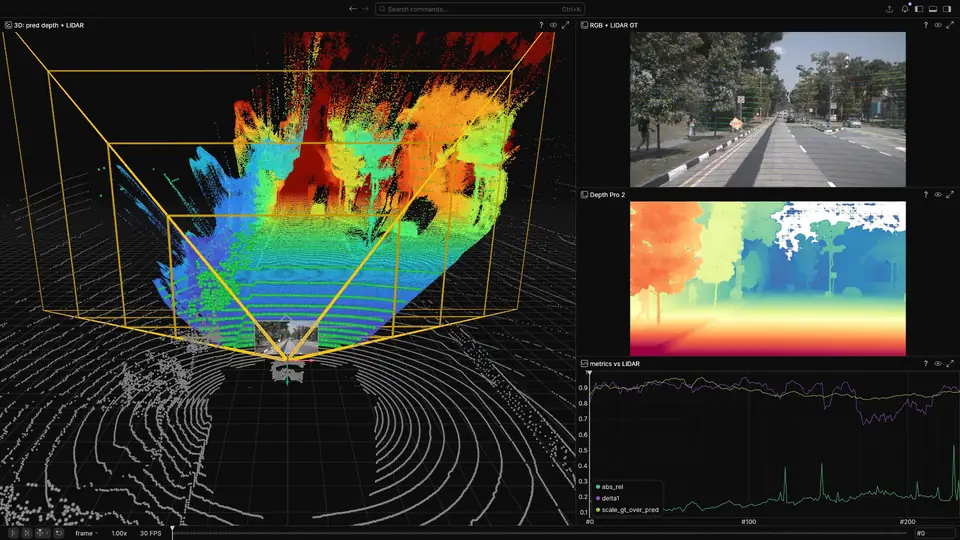

# depthpro2-cars

Run Apple's [Depth Pro 2](ml-depth-pro-2/) metric depth model on nuScenes front-camera driving
sequences, score it against LiDAR, visualize it in [Rerun](https://rerun.io), and render shareable
videos.

- Full write-up (method, metrics, assumptions, results): [`explination/technical_details.html`](explination/technical_details.html)
- Instructions for coding agents: [`AGENTS.md`](AGENTS.md)

## Demo

[](media/scene-0796_depthpro2-h_rerun.mp4)

Depth Pro 2 H+ at full resolution on nuScenes scene-0796, recorded from the Rerun viewer.
Left: predicted depth as a 3D point cloud, the camera's field of view (yellow), LiDAR used as
ground truth (green: in front of the camera and inside the image) and LiDAR filtered out (gray).
Right: camera image, colored depth, and per-frame metrics against LiDAR.
The preview is half size at 6 fps. **[Full video (1920×1080, 12 fps)](media/scene-0796_depthpro2-h_rerun.mp4)**.
Data: nuScenes (CC BY-NC-SA 4.0), see [licenses](#licenses-and-citation).

## Setup

Tested on an Apple M3 Max (64 GB). The model runs on the Apple GPU (MPS).

```bash
source .envrc.sh                                   # keep all caches inside the project
/opt/homebrew/bin/python3.12 -m venv .venv         # Python 3.12
.venv/bin/pip install -e ./ml-depth-pro-2 "rerun-sdk>=0.24"
```

Use **`.venv/bin/rerun`** to open recordings. An older `rerun` elsewhere on your PATH may not read
files written by rerun-sdk 0.43 (you'd see an empty scene and a "transport error").

## Get the data and weights (not in repo)

Neither is redistributed here. Each comes under its own license, which you accept when you
download it (details: [`THIRD_PARTY_NOTICES.md`](THIRD_PARTY_NOTICES.md)).

```bash
source .envrc.sh

# nuScenes v1.0-mini (~4 GB download, ~5 GB on disk). Non-commercial use only:
# read https://www.nuscenes.org/terms-of-use first; the flag confirms you accept it.
.venv/bin/python download_data.py --nuscenes-mini --accept-nuscenes-terms

# Depth Pro 2 weights (research use only, ml-depth-pro-2/LICENSE_MODEL).
# Optional: they also download automatically on first use. This pre-fetches and verifies them.
.venv/bin/python download_data.py --weights h        # H+ 3.5 GB; also s (97 MB), b (386 MB), l (1.3 GB)
```

Downloads resume if interrupted and are checked against the server's file size. Alternatively,
create a free account at [nuscenes.org](https://www.nuscenes.org/nuscenes#download), download
**Mini**, and extract it to `data/nuscenes/` (folders `samples/`, `sweeps/`, `maps/`, `v1.0-mini/`).

**Quick demo** (after the two downloads; about 1 minute on an M3 Max, plus model loading):
```bash
.venv/bin/python run_nuscenes.py --model depthpro2-h --scale 0.5 --scene scene-0796 --max-frames 64 --spawn
```

## Usage

```bash
source .envrc.sh

# One scene → live Rerun viewer (H+ at half resolution: ~1.4 fps, same accuracy as full res)
.venv/bin/python run_nuscenes.py --model depthpro2-h --scale 0.5 --scene scene-0796 --spawn

# Or save a recording and open it later
.venv/bin/python run_nuscenes.py --model depthpro2-h --scale 0.5 --scene scene-0796 --out out/viz
.venv/bin/rerun out/viz/scene-0796_depthpro2-h_x0.5.rrd

# Shareable MP4: input on top, colored depth below
.venv/bin/python make_video.py --scene scene-0796        # → out/video/scene-0796_depthpro2-h.mp4

# Video of the whole Rerun window (headless viewer, frame by frame) → out/video/<name>_rerun.mp4
.venv/bin/python record_rerun_video.py out/viz/scene-0796_depthpro2-h.rrd

# Benchmark: 4 models × 4 scenes × 64 frames, full resolution (~65 min), then the ranking table
MAX_FRAMES=64 OUT=out/bench64 ./bench.sh depthpro2-s depthpro2-b depthpro2-l depthpro2-h
.venv/bin/python compare.py out/bench64
```

Main `run_nuscenes.py` options: `--model` (`depthpro2-s|b|l|h`), `--scene`, `--scale`,
`--max-frames`, `--window`/`--overlap` (16/4), `--precision` (bf16), `--estimate-focal`,
`--no-rrd`, `--spawn`.

## How scoring works (short version)

- **Ground truth:** the nearest LiDAR sweep in time, projected into the camera with ego-motion
  compensation. Only points **in front of the camera** (z > 1 m) and **inside the image** are kept.
- **Compared quantity:** depth along the camera axis (z-depth), in meters. No scale alignment.
- **Metrics** (LiDAR depth 1–80 m): **AbsRel** (mean relative error, lower is better),
  **δ<1.25** (share of points within 25%, higher is better), **RMSE** in meters, and the
  **LiDAR ÷ predicted** scale ratio (1.0 = no bias).

## Results (4 scenes × 64 frames, full resolution)

| Model | AbsRel ↓ | δ<1.25 ↑ | RMSE (m) | LiDAR ÷ pred | fps (M3 Max) |
|---|---|---|---|---|---|
| **H+** | **0.161** | **85.5%** | **5.23** | 0.889 | 0.12 |
| L | 0.179 | 83.2% | 5.28 | 0.877 | 0.23 |
| B | 0.182 | 79.9% | 5.85 | 0.888 | 0.67 |
| S | 0.207 | 72.8% | 6.38 | 0.854 | 1.47 |

- H+ is the most accurate. At half resolution it is ~11× faster with the same accuracy (tested on one scene).
- All models place objects ~10–15% too far away.
- Night scenes are the hardest case for every model.

See the [write-up](explination/technical_details.html) for per-scene results, speed experiments,
assumptions and limitations.

## Project layout

| Path | Purpose |
|---|---|
| `download_data.py` | Download nuScenes mini and/or model weights (resumable, size-checked) |
| `run_nuscenes.py` | Model + LiDAR scoring → Rerun `.rrd` and metrics `.json` |
| `make_video.py` | Model → MP4 |
| `record_rerun_video.py` | Rerun recording → MP4 of the full viewer window (no screen capture) |
| `bench.sh`, `compare.py` | Run the benchmark / print tables |
| `ml-depth-pro-2/` | Apple's code (vendored, unmodified) |
| `out/` | Results, recordings, videos (`out/bench64/` = reference benchmark) |
| `explination/` | Technical write-up and figures |
| `media/` | Demo video and its preview (nuScenes-derived, see licenses) |

## Licenses and citation

Full list per component, with obligations: **[`THIRD_PARTY_NOTICES.md`](THIRD_PARTY_NOTICES.md)**.

| Part | License | In this repo? |
|---|---|---|
| This project's own code and docs | [MIT](LICENSE) | Included |
| Depth Pro 2 code (`ml-depth-pro-2/`, Apple) | Apple license ([`LICENSE`](ml-depth-pro-2/LICENSE)) | Included, unmodified |
| Depth Pro 2 weights (Apple) | Apple ML Research Model License ([`LICENSE_MODEL`](ml-depth-pro-2/LICENSE_MODEL)): **research use only** | No, downloaded |
| nuScenes v1.0-mini (Motional) | [CC BY-NC-SA 4.0](https://creativecommons.org/licenses/by-nc-sa/4.0/) + [nuScenes Terms of Use](https://www.nuscenes.org/terms-of-use): **non-commercial** | No, downloaded |
| Figures in `explination/assets/`, demo video in `media/` | Adapted from nuScenes: CC BY-NC-SA 4.0 (same license, attribution in the notices file) | Included |
| Python packages (PyTorch, Rerun, PyAV, …) | Mostly BSD/MIT/Apache. PyAV's wheel bundles GPL codecs (x264/x265); see the notices file | No, pip-installed |

Not affiliated with or endorsed by Apple or Motional. If you use this work, cite Depth Pro 2
(arXiv:2611.26603) and nuScenes (arXiv:1903.11027); the BibTeX is in
[`THIRD_PARTY_NOTICES.md`](THIRD_PARTY_NOTICES.md#citations).
